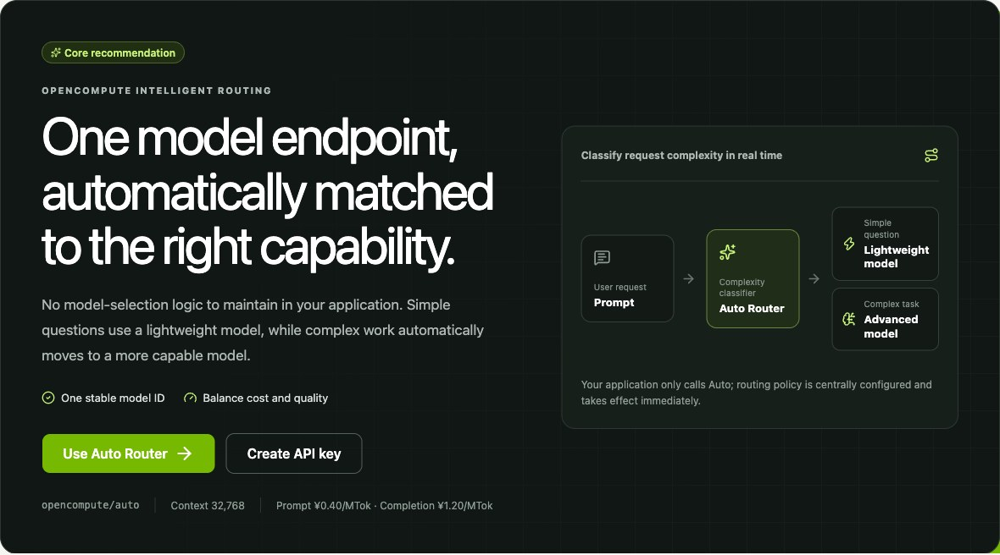
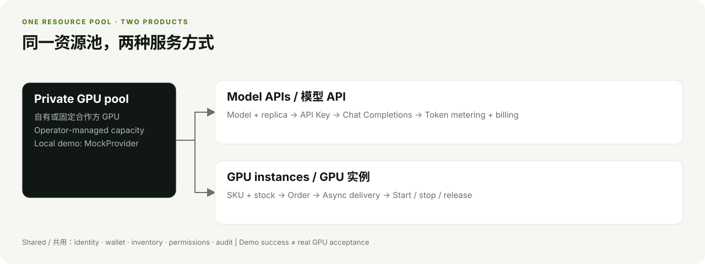
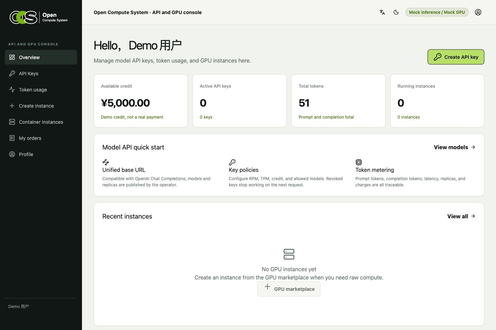
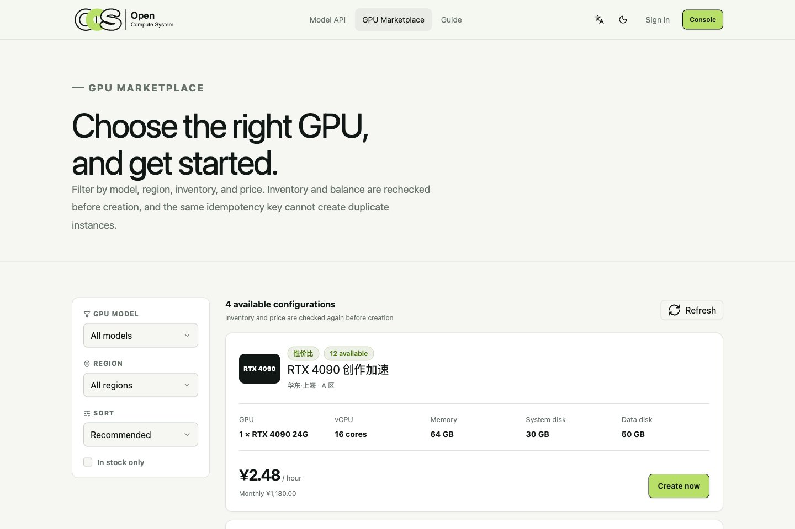
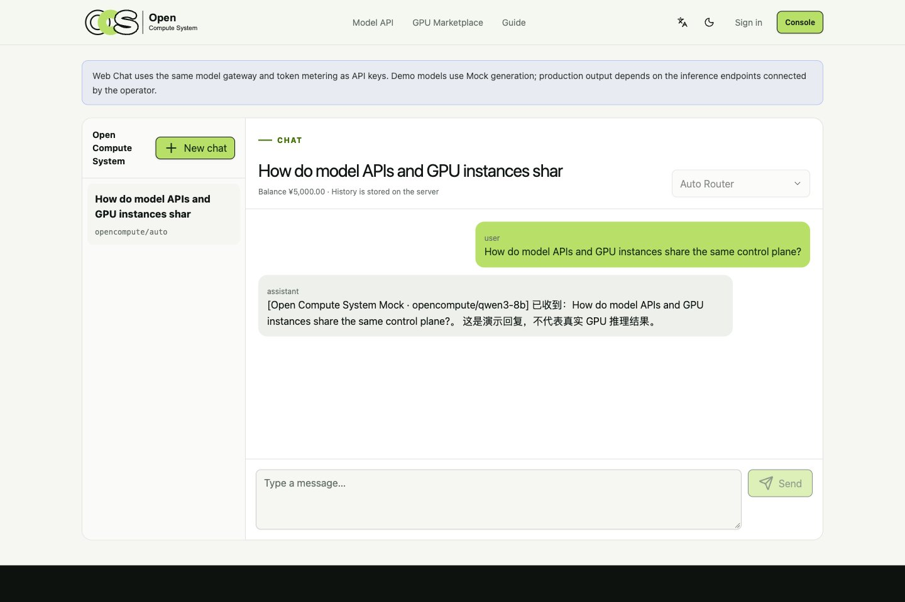
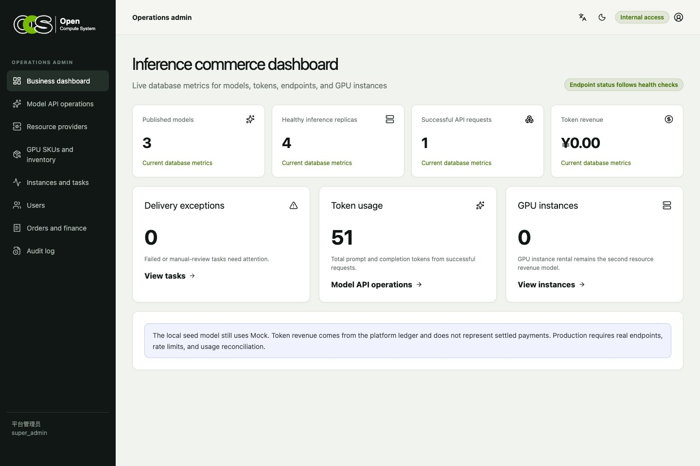
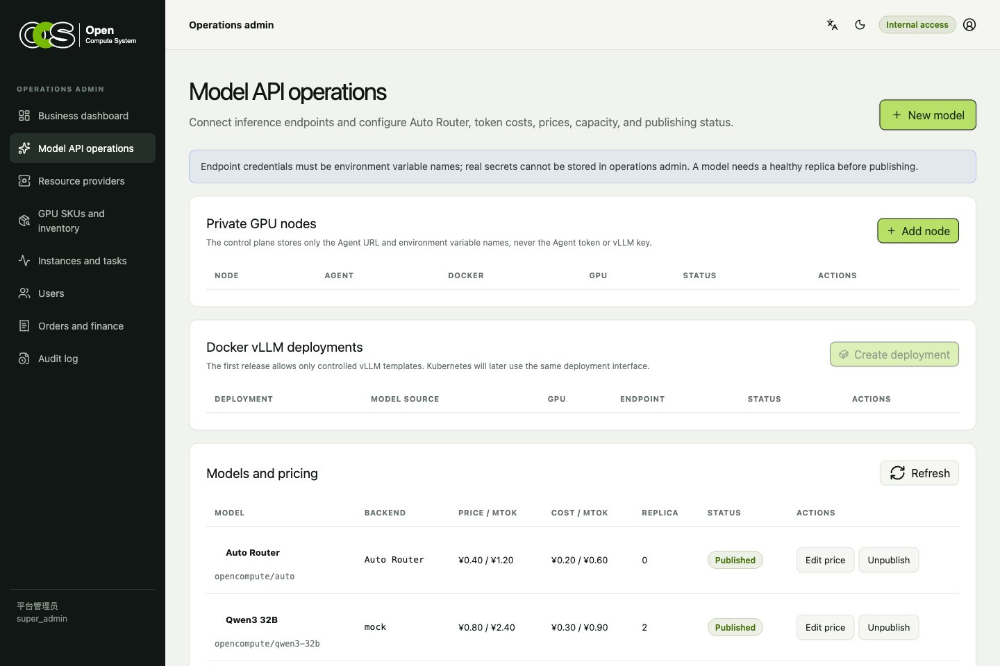
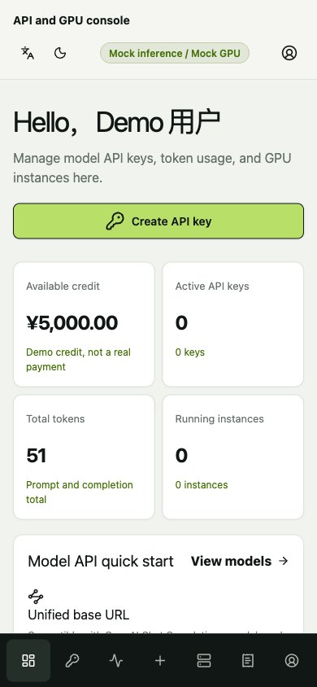
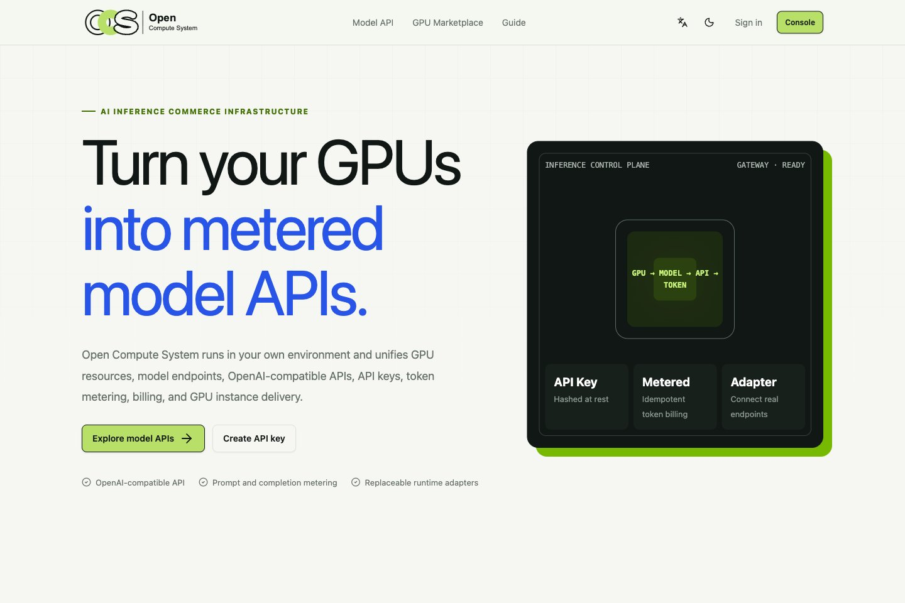
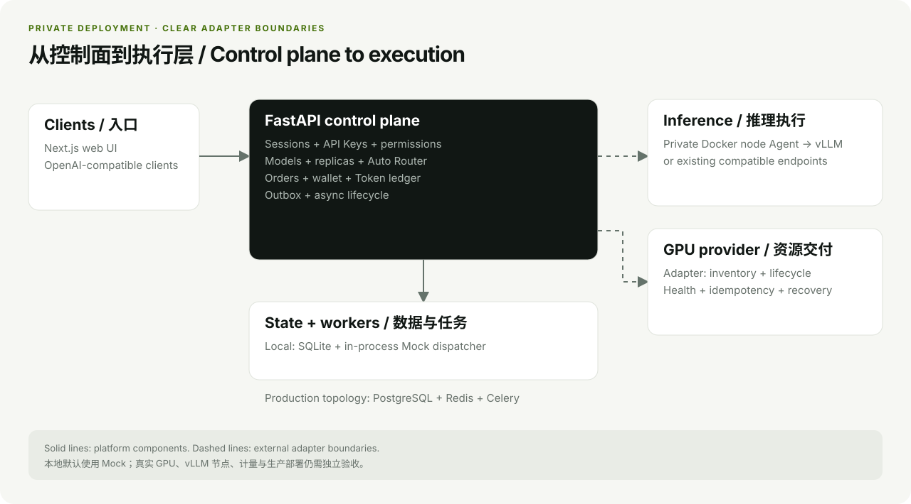

# Open Compute System

**Turn your GPU capacity into metered model APIs and rentable instances.**

A self-hosted control plane for GPU operators: model endpoints, OpenAI-compatible APIs, API keys,
Token billing, GPU inventory, instance delivery, and an operations console in one private deployment.

English | [简体中文](README.zh-CN.md)

[](LICENSE)
[](api/pyproject.toml)
[](web/package.json)

[Quick start](#quick-start) · [Product tour](#product-tour) · [Architecture](#architecture) · [Documentation](docs/README.md)

**[Try the live demo](https://demo.v2ai.org/open-compute-system)** · User: `demo@opencompute.local` · Password: `Demo12345`

The live site is a shared Mock sandbox. Do not enter personal data or real API keys. Admin access and changes to login identities are disabled; explore operations locally.



*Actual local UI. Auto Router is configurable; the screenshot uses seeded Mock models.*

> [!IMPORTANT]
> The local demo uses **SQLite + Mock GPU/inference adapters**, with no GPU or Redis required.
> Real GPU delivery, vLLM execution, Token reconciliation, payments, and production operation still
> need external acceptance. See [implementation status](#implementation-status).

## One resource pool, two products

| Sell inference | Rent GPU instances |
| --- | --- |
| Publish models and replicas behind an OpenAI-compatible API. Manage keys, model access, usage, and per-Token charges. | Publish SKUs and stock, accept orders, reserve inventory, and deliver instances through asynchronous lifecycle tasks. |

Both paths share accounts, wallet balances, permissions, and audit records. Your organization keeps
its hardware, models, customers, prices, and operating data in its own deployment.



## Product tour

Click any screenshot to open the full image.

| User console | GPU marketplace |
| --- | --- |
|  |  |
| One place for API usage and GPU instances. | Browse stock and choose a billing period. |

| Web Chat | Operations dashboard |
| --- | --- |
|  |  |
| Try published models and revisit conversation history. | Monitor models, usage, and delivery exceptions. |

<details>
<summary><strong>More screenshots: model operations, mobile console, and homepage</strong></summary>

### Model operations

Configure public models, replicas, pricing, and Auto Router policies. Node and deployment controls
are present; real Docker/NVIDIA execution requires separate acceptance.



### Mobile console



### Homepage



</details>

All screenshots were captured from the running app on **2026-11-07**, using an isolated local demo
database and seeded data. Prices, balances, metrics, and replies are demonstrations, not operating
results. See [screenshot provenance](docs/assets/README.md).

## What works today

| Area | Implemented | Boundary |
| --- | --- | --- |
| Model API | OpenAI-compatible Chat Completions, streaming, API keys, usage, billing | Default inference is Mock |
| Auto Router | Single model ID, configurable simple/complex routing, fallback, telemetry | Real-model quality and usage need validation |
| Inference operations | Models, replicas, publishing, health checks, basic failover | Real vLLM nodes need acceptance |
| GPU marketplace | SKU filters, multiple billing periods, inventory | Default resource provider is Mock; supplier cost stays internal |
| Orders and instances | Idempotency, debit/refund, stock reservation, Outbox, async lifecycle | Mock SSH/Jupyter addresses are not reachable machines |
| Accounts and admin | Phone/email identities, HttpOnly sessions, server-side permissions, audit | SMS/email verification and production MFA setup are external |
| Private node agent | Authenticated, controlled Docker vLLM create/inspect/stop APIs | Requires real Docker/NVIDIA host validation |

Group buying, bare-metal lead generation, an open supplier marketplace, a custom GPU scheduler, and
CRM are outside the current product scope.

## Quick start

Requirements: **Python 3.12+**, [uv](https://docs.astral.sh/uv/), **Node.js 22**, and **pnpm 11.20**.
The default demo runs on a laptop without a GPU, Docker, PostgreSQL, or Redis.

```bash
git clone https://github.com/open-v2ai/open-compute-system.git
cd open-compute-system

# API dependencies and local SQLite migrations
cd api
uv sync --frozen
uv run --frozen python scripts/upgrade_database.py
cd ..

# Web dependencies
cd web
pnpm install --frozen-lockfile
cd ..
```

Start each service in its own terminal:

```bash
# Terminal 1 — API: http://127.0.0.1:8000
make dev-api
```

```bash
# Terminal 2 — Web: http://127.0.0.1:3000
make dev-web
```

Open [the web app](http://127.0.0.1:3000), [the admin portal](http://127.0.0.1:3000/admin/login),
or [the API docs](http://127.0.0.1:8000/api/docs). Demo data is seeded on API startup.

### Demo accounts

| Portal | Identity | Password | MFA |
| --- | --- | --- | --- |
| User | `demo@opencompute.local` or `13800138000` | `Demo12345` | — |
| Admin | `admin` | `Admin12345` | `123456` |

These are public, non-production demo credentials. They only work with demo seeding enabled.

### Try a model API

1. Sign in and create an API key under **Console → API Keys**. Copy it when shown once.
2. Choose a model ID from the catalog; the example below uses `opencompute/qwen3-8b`.
3. Set `OCS_API_KEY` in your shell, then make a request:

```bash
curl http://127.0.0.1:8000/api/v1/chat/completions \
  -H "Authorization: Bearer ${OCS_API_KEY}" \
  -H "Content-Type: application/json" \
  -H "X-Request-ID: $(uuidgen)" \
  -d '{"model":"opencompute/qwen3-8b","messages":[{"role":"user","content":"Hello"}]}'
```

The local reply is explicitly marked as Mock. View the recorded Tokens and charge under
**Console → Token usage**.

## Deployment options

Bundled PostgreSQL/Redis remain the default. For shared data services and an existing reverse proxy, use `make start DEPENDENCIES=external INGRESS=host`. See the [deployment and sizing guide](docs/setup/DEPLOYMENT.md) for credentials, isolation, shared data-service configuration, private previews, and resource limits.

## Architecture



The web app uses same-origin `/api/v1` requests and HttpOnly Cookie sessions. FastAPI owns business
rules, permissions, transactions, and the OpenAPI contract. Providers adapt external GPU resources;
the private node agent only accepts controlled Docker vLLM operations.

| Local demo | Production topology provided in the repository |
| --- | --- |
| SQLite, Mock adapters, in-process Outbox dispatcher | PostgreSQL, Redis, Celery, Nginx, private Agent, and configured GPU/inference adapters |

The production topology is a deployment path, not evidence of production acceptance.

| Directory | Purpose |
| --- | --- |
| `api/` | FastAPI, SQLAlchemy Async, Alembic, Celery |
| `web/` | Next.js 16, React 19, TypeScript, shadcn/ui, Lucide |
| `agent/` | Controlled Docker vLLM node execution |
| `deploy/` | Local dependencies and production Compose/Nginx configuration |
| `docs/` | Product scope, architecture, acceptance evidence, and release guidance |

Read [technical architecture](docs/architecture/TECHNICAL_ARCHITECTURE.md),
[Auto Router](docs/architecture/AUTO_ROUTER.md), and
[the node agent design](docs/architecture/VLLM_NODE_AGENT.md) for details.

## Development and verification

```bash
make install             # API, Agent, and Web dependencies
make check               # Static checks + Web tests
make test                # API, Agent, and Web tests
make build               # Next.js production build
make open-source-check   # Repository hygiene and local documentation links
```

After a backend schema change, run `make generate-client`. Never hand-edit
`web/lib/api/generated/`; FastAPI OpenAPI is the single source of truth.

## Integrating real resources

- GPU provider: `api/app/providers/base.py` and `api/app/providers/example.py`.
- Inference runtime: `api/app/providers/inference_base.py`.
- Private execution: [Docker vLLM node agent](docs/architecture/VLLM_NODE_AGENT.md).

Validate health, idempotency, timeouts, error mapping, metering, and repeated delivery against the
actual infrastructure before enabling it for customers.

## Implementation status

This is an open-source development baseline. The following external prerequisites remain:

- Real GPU provider APIs and Docker/NVIDIA/vLLM host acceptance.
- Real endpoint model identity, licensing, Token reconciliation, and production RPM/TPM limits.
- SMS/email ownership verification, payments, identity verification, and reachable SSH/Jupyter.
- Backups, certificates, domain setup, production deployment, and final legal documents.

See the [current product PRD](docs/business/PRODUCT_PRD.md),
[MVP acceptance](docs/setup/MVP_ACCEPTANCE.md), and
[production checklist](docs/setup/PRODUCTION_CHECKLIST.md). Planning documents describe future work;
they do not expand the implemented feature set.

## Contributing and license

Read [CONTRIBUTING.md](CONTRIBUTING.md), [CODE_OF_CONDUCT.md](CODE_OF_CONDUCT.md), and
[SUPPORT.md](SUPPORT.md). Report suspected vulnerabilities privately as described in
[SECURITY.md](SECURITY.md).

[Changelog](CHANGELOG.md) · [Documentation index](docs/README.md) ·
[Publication checklist](docs/OPEN_SOURCE_CHECKLIST.md)

Licensed under [Apache License 2.0](LICENSE).
