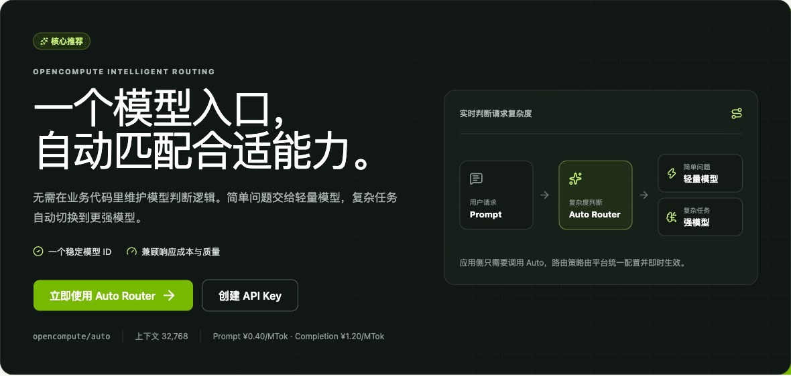
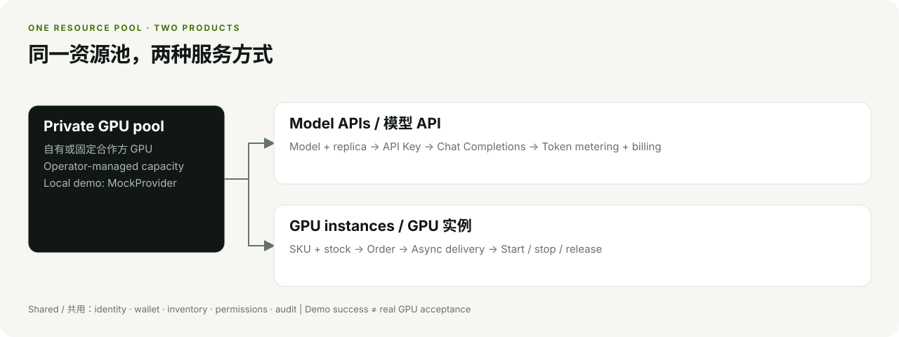
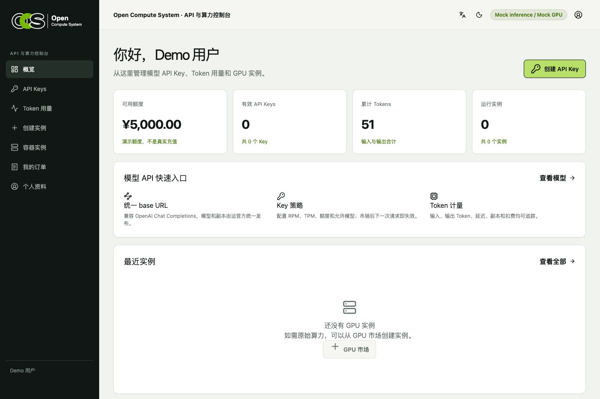
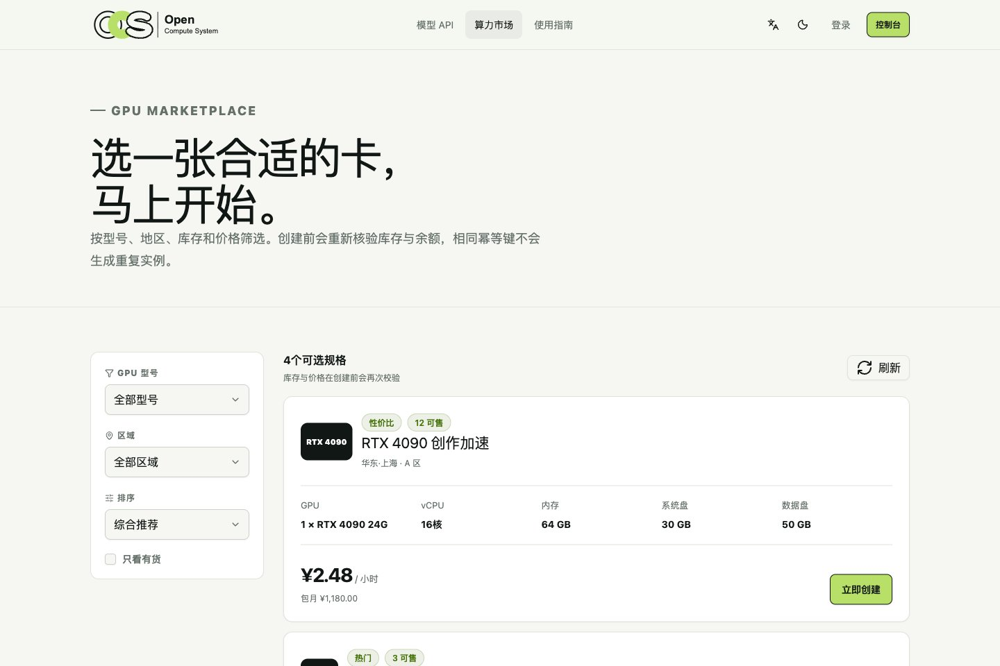
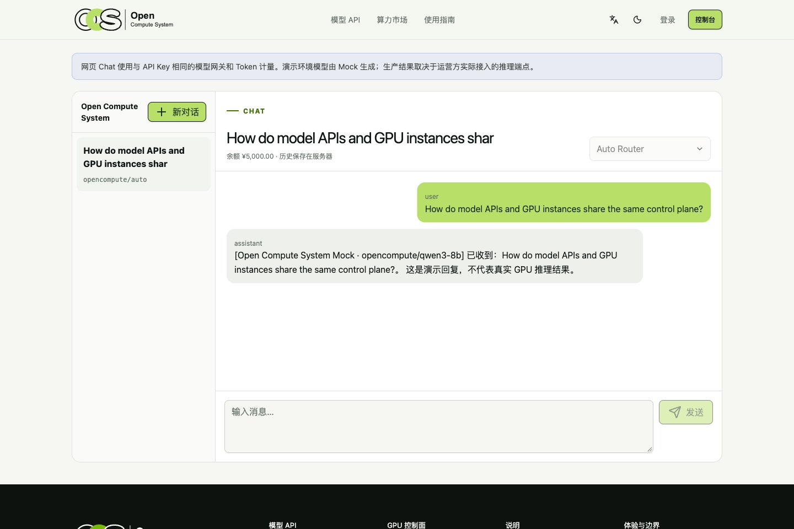
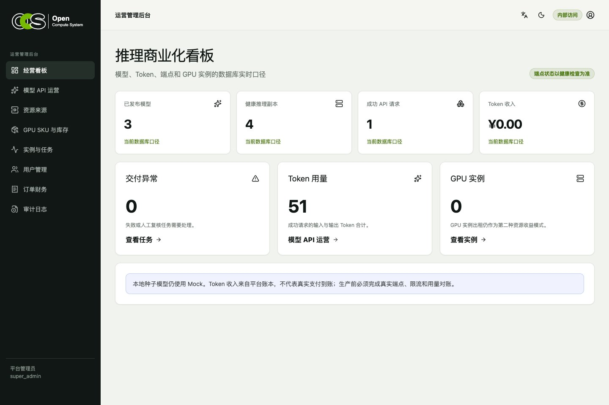
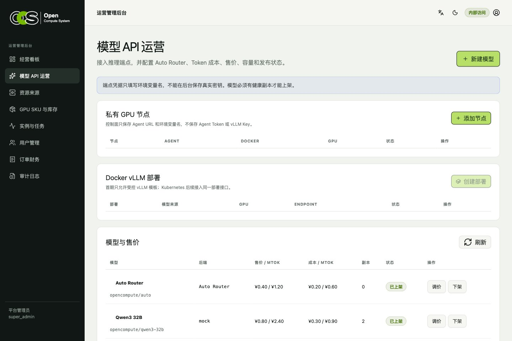
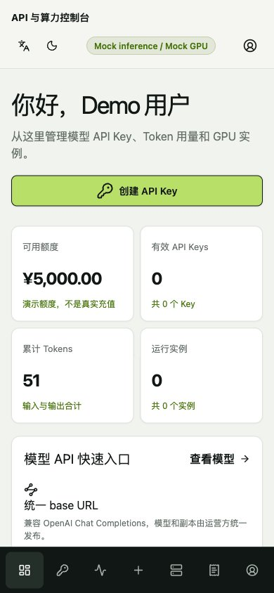
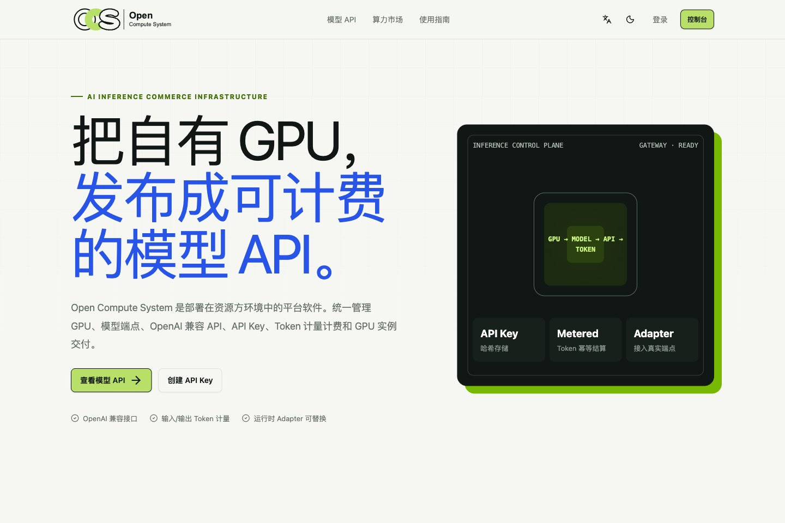
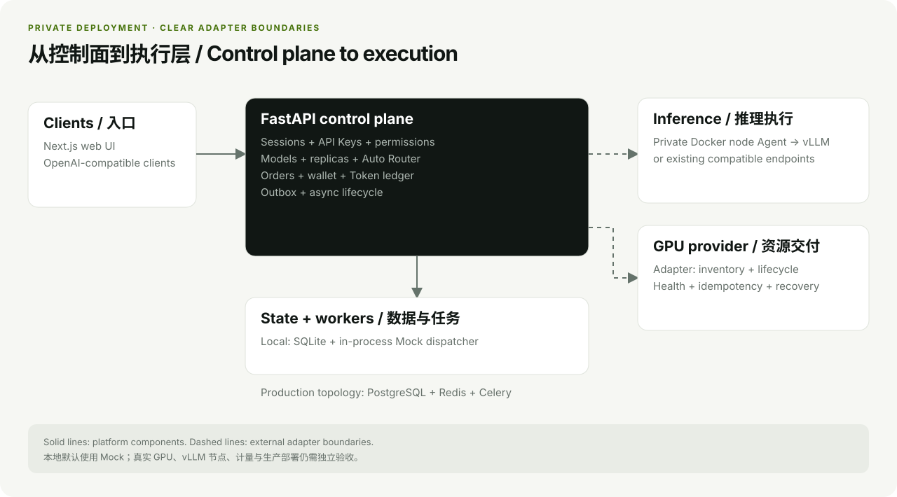

# Open Compute System

**把自有 GPU，变成可计费的模型 API 和可出租的算力实例。**

面向 GPU 资源运营方的自托管控制面：在自己的环境中统一管理模型端点、OpenAI 兼容 API、
API Key、Token 计费、GPU 库存、实例交付和运营后台。

[English](README.md) | 简体中文

[](LICENSE)
[](api/pyproject.toml)
[](web/package.json)

[快速开始](#快速开始) · [界面预览](#界面预览) · [系统架构](#系统架构) · [文档索引](docs/README.md)

**[在线体验 Demo](https://demo.v2ai.org/open-compute-system)** · 账号：`demo@opencompute.local` · 密码：`Demo12345`

体验站使用共享 Mock 数据，请勿输入个人信息或真实密钥。线上不开放运营后台和登录方式修改；后台功能可按下文步骤在本地体验。



*实际本地界面。Auto Router 可配置；图中使用的是演示种子中的 Mock 模型。*

> [!IMPORTANT]
> 本地演示默认使用 **SQLite + Mock GPU / 推理适配器**，不需要 GPU 或 Redis。
> 真实 GPU 交付、vLLM 执行、Token 对账、支付和生产运行仍需独立验收，详见[当前实现边界](#当前实现边界)。

## 一套资源池，两种服务方式

| 提供模型 API | 出租 GPU 实例 |
| --- | --- |
| 发布模型与副本，提供 OpenAI 兼容接口，管理 Key、模型权限、用量和 Token 扣费。 | 发布 SKU 与库存，接受订单、预占资源，通过异步任务交付实例并管理生命周期。 |

两条业务路径共用账号、余额、权限与审计。硬件、模型、客户、定价和经营数据保留在运营方自己的部署中。



## 界面预览

点击图片可以查看原图。

| 用户控制台 | GPU 算力市场 |
| --- | --- |
|  |  |
| 在同一入口管理模型 API 与 GPU 实例。 | 查看库存与多周期价格，选择合适的 SKU。 |

| 网页 Chat | 运营看板 |
| --- | --- |
|  |  |
| 试用已发布模型，查看保存的会话历史。 | 从模型、用量和异常任务了解当前状态。 |

<details>
<summary><strong>更多截图：模型运营、手机控制台、首页</strong></summary>

### 模型 API 运营

管理公开模型、副本、价格和 Auto Router 路由策略。页面已提供节点与部署操作入口；
真实 Docker / NVIDIA 执行仍需单独验收。



### 手机控制台



### 项目首页



</details>

截图于 **2026-11-07** 从实际运行的应用中采集，使用独立本地演示数据库和种子数据。
其中价格、余额、指标及回复均为演示，不代表真实经营结果。详见[截图来源说明](docs/assets/README.md)。

## 当前能力

| 领域 | 已实现 | 当前边界 |
| --- | --- | --- |
| 模型 API | OpenAI 兼容 Chat Completions、流式响应、Key、用量和扣费 | 默认推理运行时为 Mock |
| Auto Router | 统一模型 ID、简单/复杂任务路由、保底策略、路由记录 | 真实模型效果与用量待验收 |
| 推理运营 | 模型/副本、上下架、健康检查、基础故障切换 | 真实 vLLM 节点待验收 |
| GPU 市场 | SKU 筛选、多周期价格、库存 | 默认 Provider 为 Mock；供应成本仅后台可见 |
| 订单与实例 | 幂等、扣款/失败退款、库存预占、Outbox、异步生命周期 | Mock SSH / Jupyter 地址不能当作真机 |
| 账号与后台 | 手机号/邮箱身份、HttpOnly 会话、服务端权限、审计 | 短信/邮件验证、生产 MFA 配置为外部前提 |
| 私有节点 Agent | 受认证、受控的 Docker vLLM 创建/查询/停止 API | 真实 Docker / NVIDIA 主机待验收 |

拼租、裸金属询价、线索池、开放供应商市场、自研 GPU 调度器和完整 CRM 不属于当前产品范围。

## 快速开始

要求：**Python 3.12+**、[uv](https://docs.astral.sh/uv/)、**Node.js 22**、**pnpm 11.20**。
默认演示可以在普通电脑运行，不需要 GPU、Docker、PostgreSQL 或 Redis。

```bash
git clone https://github.com/open-v2ai/open-compute-system.git
cd open-compute-system

# 安装 API 依赖，升级本地 SQLite 数据库
cd api
uv sync --frozen
uv run --frozen python scripts/upgrade_database.py
cd ..

# 安装 Web 依赖
cd web
pnpm install --frozen-lockfile
cd ..
```

在两个终端分别启动：

```bash
# 终端 1 — API：http://127.0.0.1:8000
make dev-api
```

```bash
# 终端 2 — Web：http://127.0.0.1:3000
make dev-web
```

打开[用户界面](http://127.0.0.1:3000)、[运营后台](http://127.0.0.1:3000/admin/login)或
[API 文档](http://127.0.0.1:8000/api/docs)。API 启动时会创建演示种子数据。

### 演示账号

| 入口 | 登录身份 | 密码 | MFA |
| --- | --- | --- | --- |
| 用户端 | `demo@opencompute.local` 或 `13800138000` | `Demo12345` | — |
| 运营后台 | `admin` | `Admin12345` | `123456` |

以上是公开的非生产演示凭据，仅在启用演示种子时可用。

### 试一次模型 API

1. 登录后进入 **控制台 → API Keys**，创建 Key，并在首次显示时复制。
2. 在模型目录选择模型 ID，以下示例使用 `opencompute/qwen3-8b`。
3. 在终端设置 `OCS_API_KEY` 环境变量，然后发起请求：

```bash
curl http://127.0.0.1:8000/api/v1/chat/completions \
  -H "Authorization: Bearer ${OCS_API_KEY}" \
  -H "Content-Type: application/json" \
  -H "X-Request-ID: $(uuidgen)" \
  -d '{"model":"opencompute/qwen3-8b","messages":[{"role":"user","content":"Hello"}]}'
```

本地回复会明确标注 Mock。随后可以在 **控制台 → Token 用量** 查看记录和扣费。

## 部署方式

默认仍自建 PostgreSQL / Redis。需要复用共享数据库、Redis 和现有反向代理时，可使用 `make start DEPENDENCIES=external INGRESS=host`。配置步骤、资源建议和私有演示入口见[部署指南](docs/setup/DEPLOYMENT.md)；共享依赖由部署方独立管理，无需访问私有仓库即可使用默认自建模式。

## 系统架构



Web 通过同源 `/api/v1` 请求和 HttpOnly Cookie 会话访问 API；FastAPI 负责业务规则、
权限、事务和 OpenAPI 契约。Provider 适配外部 GPU 资源；私有节点 Agent 只接受受控的 Docker vLLM 操作。

| 本地演示默认配置 | 仓库提供的生产部署拓扑 |
| --- | --- |
| SQLite、Mock 适配器、进程内 Outbox Dispatcher | PostgreSQL、Redis、Celery、Nginx、私有 Agent 与已配置的 GPU / 推理适配器 |

提供生产部署拓扑，不等于已经完成生产验收。

| 目录 | 说明 |
| --- | --- |
| `api/` | FastAPI、SQLAlchemy Async、Alembic、Celery |
| `web/` | Next.js 16、React 19、TypeScript、shadcn/ui、Lucide |
| `agent/` | 受控的 Docker vLLM 节点执行 |
| `deploy/` | 本地依赖与生产 Compose / Nginx 配置 |
| `docs/` | 产品范围、架构、验收证据与发布说明 |

更多细节见[技术架构](docs/architecture/TECHNICAL_ARCHITECTURE.md)、
[Auto Router](docs/architecture/AUTO_ROUTER.md)和[节点 Agent 设计](docs/architecture/VLLM_NODE_AGENT.md)。

## 开发与验证

```bash
make install             # 安装 API、Agent 和 Web 依赖
make check               # 静态检查及 Web 测试
make test                # API、Agent 和 Web 测试
make build               # Next.js 生产构建
make open-source-check   # 仓库文件卫生与本地文档链接
```

后端 Schema 变化后运行 `make generate-client`。FastAPI OpenAPI 是前后端契约的单一来源，
不要手工编辑 `web/lib/api/generated/`。

## 接入真实资源

- GPU Provider：`api/app/providers/base.py` 和 `api/app/providers/example.py`。
- 推理运行时：`api/app/providers/inference_base.py`。
- 私有执行层：[Docker vLLM 节点 Agent](docs/architecture/VLLM_NODE_AGENT.md)。

面向客户启用前，需要在真实环境验证健康检查、幂等、超时、错误映射、计量和重复投递。

## 当前实现边界

当前开放的是开发基线，以下外部前提仍待完成：

- 真实 GPU Provider API 与 Docker / NVIDIA / vLLM 节点验收。
- 真实端点模型身份、商用许可、Token 对账与生产 RPM / TPM 限流。
- 短信/邮件身份验证、支付、实名认证、真实 SSH / Jupyter 可达性。
- 备份、证书、域名、生产部署与正式法律文本。

参见[现行产品 PRD](docs/business/PRODUCT_PRD.md)、[MVP 验收说明](docs/setup/MVP_ACCEPTANCE.md)
和[生产检查清单](docs/setup/PRODUCTION_CHECKLIST.md)。规划文档中的未来能力不代表当前已实现。

## 贡献与许可证

参与贡献前请阅读[贡献指南](CONTRIBUTING.md)、[行为准则](CODE_OF_CONDUCT.md)和
[支持说明](SUPPORT.md)。疑似漏洞请按[安全政策](SECURITY.md)私密报告。

[版本记录](CHANGELOG.md) · [文档索引](docs/README.md) · [开源发布检查清单](docs/OPEN_SOURCE_CHECKLIST.md)

本项目使用 [Apache License 2.0](LICENSE)。
